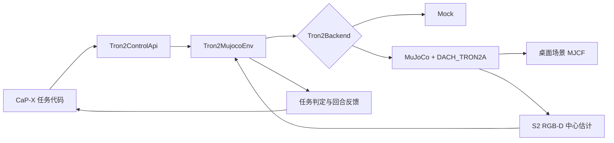

# TRON2 架构与扩展

[运行和验收](tron2_bringup.md) · [真机接入路线](tron2_hardware.md)

CaP-X 的任务代码通过六个高层工具操作机器人。任务提示、参考程序和工具签名由各模式共用。更换运动后端或物体位置来源时，任务代码仍使用同一套坐标与返回值。

## 代码组织

| 层 | 实现 | 职责 |
| --- | --- | --- |
| 任务 | [`capx/envs/tasks/tron2/`](../capx/envs/tasks/tron2/) | Cube Lift 和 Pick & Place 的任务提示、Oracle 及回合反馈。 |
| 环境 | [`tron2_mujoco.py`](../capx/envs/simulators/tron2_mujoco.py) | CaP-X `BaseEnv` 实现，负责种子复位、观测、动作和回合预算、稳定性判定与奖励。 |
| 工具 | [`control.py`](../capx/integrations/tron2/control.py) | `Tron2ControlApi` 暴露 Agent 可以调用的六个工具。 |
| 后端 | [`backends.py`](../capx/integrations/tron2/backends.py)、[`mujoco_backend.py`](../capx/integrations/tron2/mujoco_backend.py) | 共享 `Tron2Backend` 协议及 Mock。MuJoCo 后端负责仿真运动、接触、关节与相机状态。 |
| 场景 | [`tabletop.xml`](../capx/envs/assets/tron2_tasks/tabletop.xml) | 自有桌面、两个自由方块、目标标记、外部相机与接触参数。放在 CaP-X 的环境资产目录中，随包分发。 |
| 感知与检查 | [`perception.py`](../capx/integrations/tron2/perception.py)、[`safety.py`](../capx/integrations/tron2/safety.py) | S2 利用 RGB-D 估计中心。通用检查校验手臂、位姿和速度，模型相关的工作空间、IK、关节、碰撞和运动超时检查由 MuJoCo 后端负责。 |
| 配置与回归 | [`env_configs/tron2/`](../env_configs/tron2/)、[`tests/tron2/`](../tests/tron2/) | 两项任务的六份配置，通过标准 CaP-X 入口验证和复现。 |

MuJoCo 后端加载外部官方 `robot_grasper.xml` 和网格，将桌面场景并入固定基座的模型。头部和腕部相机、TCP 与指尖接触面依赖具体连杆，仍由后端按型号装配。仿真直接推进 MuJoCo；真机传输将由单独的适配器负责。[模型来源与安装](tron2_bringup.md#2-用官方-dach_tron2a-模型评测)

## 工具和坐标约定

| 工具 | 参数 | 返回 |
| --- | --- | --- |
| `get_robot_state()` | 无 | 双臂 TCP、关节、夹爪状态、夹持状态和时间戳。 |
| `get_object_pose(name)` | `cube` 或 `target` | 方块中心或目标静置中心的位姿，观测失败时抛出 `ObservationUnavailableError`。 |
| `move_ee(arm, pose_base, speed=0.1)` | `left` 或 `right`、基座系 TCP 位姿、米/秒 | 等待动作结果，返回 `success`、`code`、`message`。 |
| `open_gripper(arm)` / `close_gripper(arm)` | `left` 或 `right` | 返回相同的动作结果结构。 |
| `get_image(camera_name)` | `head`、`overview`、`left_wrist` 或 `right_wrist` | RGB、米制深度、内参 `K`、外参 `T_base_camera` 和时间戳。需开启仿真渲染。 |

- 位置以米为单位，位姿为 `[x, y, z, qw, qx, qy, qz]`。TCP 和物体位置都在 `robot_base` 系。
- `T_base_camera` 把光学坐标（右、下、前为正 X、Y、Z）变换到基座系，头部和腕部外参从当前仿真姿态求取。若已在相机光学系获得物体位姿，组合关系为 `T_base_object = T_base_camera @ T_camera_object`。
- S1 从仿真读取位姿；S2 高层工具用头部相机或外部相机估计指定颜色和尺寸的物体中心。S2 返回的单位四元数是直立任务约定，旋转未从图像测得。修改场景布局、尺寸或颜色时，需要一并验证 S2 的标定、颜色分割和工作空间裁剪。

## 任务判定与失败重试

Cube Lift 要求已夹持的方块升高至少 7 cm。Pick & Place 要求方块曾经被夹持、已释放，并落在目标中心水平半径 3.5 cm、垂直误差 1.2 cm 的范围内。两项任务都要满足至少 0.25 秒的稳定窗口。S2 使用视觉为动作提供位置，环境判分仍使用仿真物理状态。

`Tron2CodeEnv` 把动作结果、失败原因和回合状态放入 `TRON2 feedback`。例如空抓后的下一回合可以根据 `empty_grasp` 重新读取方块位置。恢复性失败可在同一场景重试，回合达到任务目标或耗尽预算后结束。

## 注册与后续开发

- 环境工厂在 [`simulators/__init__.py`](../capx/envs/simulators/__init__.py) 注册，任务和默认配置在 [`tasks/__init__.py`](../capx/envs/tasks/__init__.py) 注册，工具在 [`integrations/__init__.py`](../capx/integrations/__init__.py) 注册。现有 YAML 直接构造 `Tron2MujocoEnv`，让每次实例化持有独立场景。
- 修改任务时先跑 Mock，再用同一份 Oracle 检查 S1 和 S2。修改场景或运动逻辑时，对比两个物理配置的任务完成数和失败原因。

## 实施阶段

| 指南阶段 | 现在可以验证的内容 | 后续工作 |
| --- | --- | --- |
| P0-1 模型与控制 | 官方 DACH_TRON2A 模型、双臂 TCP、IK、仿真运动与状态回读。 | 现场核对关节方向、TCP、夹爪行程和控制器反馈。 |
| P0-2 任务场景 | 独立桌面 MJCF、种子复位、方块的物理接触抓放。 | 按真机桌面、夹爪和物体重新标定。 |
| P0-3 统一工具 | Mock 和 MuJoCo 共用高层工具及 Oracle。 | 让真机后端实现相同的动作与观测契约。 |
| P1-1 CaP-X 任务 | 两项任务、六份配置、Oracle 基线及模拟模型重试。 | 接入实际模型并记录生成成功率、任务完成率和重试。 |
| P1-2 相机与估计 | 提供 RGB-D 和仿真外参，S2 估计已知颜色方块和目标的中心。 | 完整 6D 位姿、外观与遮挡泛化，以及真机标定和时间同步。 |
| P2 真机执行 | 仿真结果可作为对照。 | 实现真机后端和独立运动服务，按[真机接入路线](tron2_hardware.md)验证保护、Oracle 和 Agent。 |

连续录像、RL 后训练与复杂双臂协作留到后续阶段。
